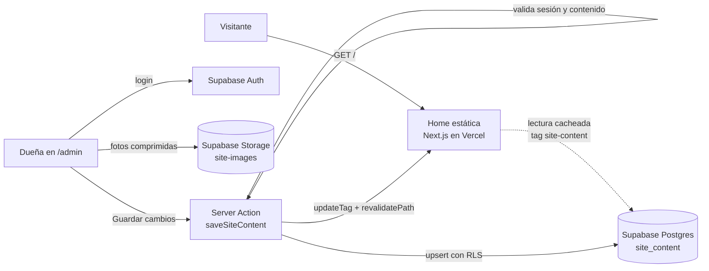

# CB Pastelera

Sitio web para CB Pastelera, una pastelería artesanal de Las Parejas (Santa Fe), con un panel de administración para que la dueña actualice textos, productos y fotos desde el celular.

Es una one-page sin carrito. Las consultas y pedidos se coordinan por WhatsApp, así que el sitio muestra el catálogo y cada botón de consulta abre un chat con el mensaje ya armado ("Hola! Quisiera consultar por Torta de chocolate."). Un checkout no tenía sentido para cómo vende hoy.

## Qué hace

**Sitio público**

- Portada, propuesta, catálogo, galería, nosotros, pedidos, Instagram y contacto en una sola página.
- Catálogo con filtro por categoría. Las categorías sin productos no aparecen y el precio es opcional.
- Galería con lightbox: teclado (flechas, Escape), swipe en celular y foco atrapado mientras está abierto.
- Links a WhatsApp con `encodeURIComponent`, botón flotante que aparece después de la portada y ubicación con link a Google Maps.
- Animaciones con Motion que respetan `prefers-reduced-motion`.
- SEO: metadata, imagen Open Graph generada en build, `sitemap.xml`, `robots.txt` y datos estructurados `Bakery` (schema.org) con la dirección cuando está cargada.

**Panel `/admin`**

- Login con email y contraseña (Supabase Auth).
- Edición por secciones en pestañas, pensada para usarse desde el teléfono.
- Alta, baja y orden de categorías, productos, fotos de la galería y fotos de Instagram.
- Las fotos se comprimen en el navegador (máximo 2000 px, WebP) antes de subirse a Supabase Storage.
- Aviso si hay cambios sin guardar. Al guardar, el sitio se actualiza en el momento.

## Stack

| Capa | Tecnología |
| --- | --- |
| Framework | Next.js 16 (App Router, Server Components, Server Actions) |
| Lenguaje | TypeScript en modo estricto |
| UI | React 19, Tailwind CSS 4, Motion, Lucide |
| Backend | Supabase: Auth, Postgres con RLS y Storage |
| Hosting | Vercel |
| Calidad | ESLint (`eslint-config-next`), Dependabot |

No hay más dependencias que esas. El cliente de Supabase es `@supabase/ssr` para manejar la sesión con cookies.

## Arquitectura

Todo el contenido editable vive en **una sola fila** de la tabla `site_content`, guardado como JSON. Para un sitio de una página con una sola persona editando, separar productos, categorías y galería en tablas era agregar complejidad sin ganar nada; con un JSON validado alcanza y el panel guarda todo de una vez.



- La home se prerenderiza estática. La lectura del contenido usa `fetch` con el tag `site-content`, y al guardar, la server action lo invalida con `updateTag` y `revalidatePath("/")`. El cambio aparece sin rebuild.
- `lib/content/parse.ts` valida el contenido en el servidor antes de cada guardado: tipos, largos máximos, links `https://`, rutas de imagen válidas y productos que apuntan a categorías existentes.
- Si Supabase no está configurado o devuelve algo inválido, el sitio usa el contenido inicial de `data/` en vez de romperse.
- `proxy.ts` (el reemplazo de `middleware` en Next 16) refresca la sesión solo en las rutas `/admin`.

## Estructura

```
app/
  page.tsx                home (lee el contenido y arma las secciones)
  admin/                  panel, login y server actions
  opengraph-image.tsx     imagen OG generada en build
  robots.ts, sitemap.ts
components/
  sections/               secciones del sitio público
  admin/                  editor del panel (campos, pestañas, productos)
  layout/                 navbar, menú mobile, footer, botón de WhatsApp
  ui/                     botones, lightbox, animaciones de entrada
data/
  business.ts             datos fijos: nombre, WhatsApp, Instagram, menú
  default-content.ts      contenido inicial de cada sección
lib/
  content/                tipos, validación y lectura del contenido
  supabase/               clientes de navegador y servidor
  admin/                  sesión, subida de fotos, helpers de listas
supabase/schema.sql       tablas, policies RLS y bucket de fotos
proxy.ts                  sesión de Supabase en /admin
```

## Puesta en marcha

### Requisitos

- Node.js 20.9 o más nuevo
- Un proyecto de Supabase (solo para el panel; el sitio corre sin él)

### Local

```bash
git clone https://github.com/EnzoDalmasso/CBPastelera.git
cd CBPastelera
npm install
cp .env.example .env.local
npm run dev
```

Sin variables de entorno el sitio levanta con el contenido de `data/` y `/admin` se abre en modo vista previa: se puede recorrer el panel, pero no guarda ni sube fotos.

| Script | Qué hace |
| --- | --- |
| `npm run dev` | Servidor de desarrollo |
| `npm run build` | Build de producción |
| `npm start` | Sirve el build |
| `npm run lint` | ESLint |
| `npm run typecheck` | `tsc --noEmit` |

### Variables de entorno

| Variable | Requerida | Para qué |
| --- | --- | --- |
| `NEXT_PUBLIC_SUPABASE_URL` | Para el panel | URL del proyecto de Supabase |
| `NEXT_PUBLIC_SUPABASE_ANON_KEY` | Para el panel | Clave anon o publishable. Nunca la `service_role` |
| `NEXT_PUBLIC_SITE_URL` | No | Dominio definitivo para canonical, Open Graph y sitemap. En Vercel, si falta, se usa el dominio de producción |

### Supabase

1. Crear el proyecto y ejecutar [`supabase/schema.sql`](supabase/schema.sql) en el SQL Editor. Crea `site_content`, `admins`, la función `is_admin()`, las policies y el bucket `site-images`.
2. En **Authentication**, desactivar el registro de usuarios nuevos y crear a mano el usuario que va a editar.
3. Darle permisos:
   ```sql
   insert into public.admins (user_id)
   select id from auth.users where email = 'mail@ejemplo.com';
   ```
4. Cargar las variables en `.env.local` y en Vercel, y hacer redeploy.

La primera vez que se guarda desde el panel, el contenido inicial de `data/` pasa a Supabase. Desde ahí manda lo que está en la base.

## Seguridad

- **Autorización con RLS.** Cualquiera puede leer `site_content` (es contenido público), pero solo insertan y actualizan los usuarios que están en `admins`. Lo mismo para subir, reemplazar o borrar archivos del bucket.
- **Doble chequeo en el servidor.** La server action verifica la sesión y el rol de admin antes de tocar la base, y valida el contenido completo. Lo que llega del cliente no se guarda tal cual.
- **Credenciales.** Al navegador solo llega la clave anon, que es pública por diseño. No hay `service_role` ni secretos en el repo; los `.env` están ignorados.
- **Cookies de sesión** con `Secure` en producción y `SameSite=Lax`.
- **Uploads.** El bucket acepta solo WebP, JPEG y PNG de hasta 5 MB, con nombres aleatorios. SVG no está permitido.
- **Headers.** CSP con `frame-ancestors 'none'`, `object-src 'none'`, `base-uri` y `form-action`, más `X-Frame-Options`, `nosniff`, `Referrer-Policy`, `Permissions-Policy` y HSTS. Sin `X-Powered-By`.
- **Panel fuera de buscadores.** `/admin` tiene `noindex`, está excluido en `robots.txt` y responde con `Cache-Control: no-store`.

## Pendientes

- **Instagram.** El feed no se puede traer sin la Graph API, que pide cuenta profesional y un token de Meta. Por ahora la dueña sube las fotos de sus posts desde el panel y puede pegar el link de cada uno.
- **Fotos de referencia.** Las fotos actuales son de Unsplash, hasta que se carguen las propias desde el panel.
- **Archivos huérfanos.** Cuando se reemplaza una foto, la anterior queda en el bucket. Con este volumen no molesta, pero conviene limpiarlo en algún momento.
- **Captcha en el login.** Supabase tiene Cloudflare Turnstile integrado. Falta activarlo y pasar el `captchaToken` desde el formulario.

## Autor

**Enzo Dalmasso** · [Infinity Code](https://web-coorporativa-infinity-code.vercel.app/)

- GitHub: [@EnzoDalmasso](https://github.com/EnzoDalmasso)
- Portfolio: [porfolio-enzo-dalmasso.vercel.app](https://porfolio-enzo-dalmasso.vercel.app/)
